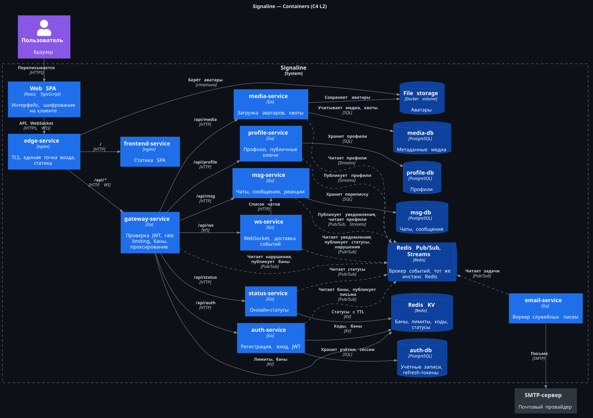
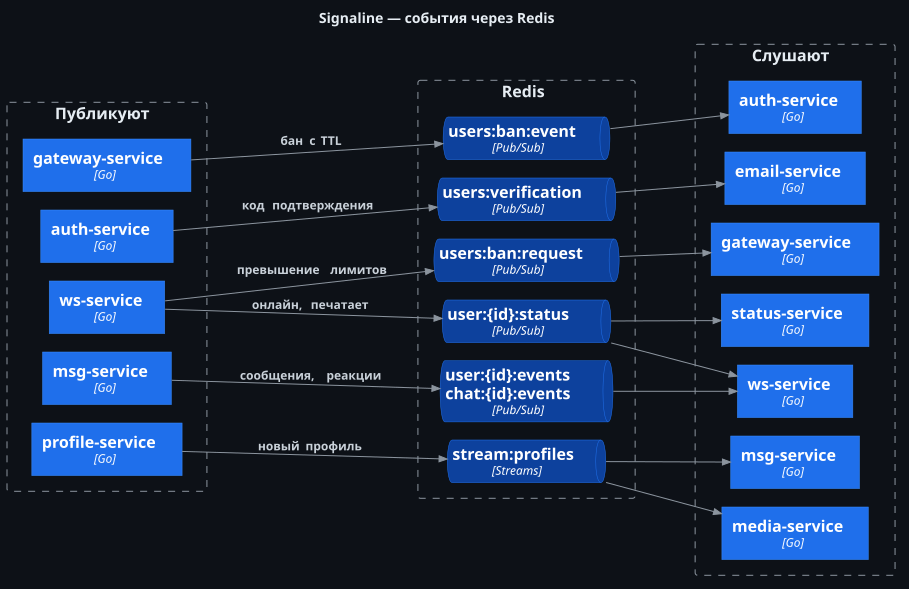

# Signaline

Мессенджер на Go-микросервисах со сквозным шифрованием: сообщения шифруются и расшифровываются в браузере, сервер хранит только шифротекст и публичные ключи. В репозитории лежат бэкенд (`services/`, `pkg/`) и клиент на React (`web/`).

> Клиент в `web/` написан ИИ-агентом и нужен только для демонстрации работы API. Предмет проекта — бэкенд.

## Стек

- **Бэкенд:** Go, Uber FX (DI), Clean Architecture
- **Хранилища:** PostgreSQL (pgx, goose), Redis (Pub/Sub, Streams, KV)
- **Транспорт:** REST, WebSocket, nginx как edge-прокси
- **Безопасность:** JWT на Ed25519, argon2id для паролей, rate limiting, баны по IP и пользователю
- **Клиент:** React, TypeScript, Vite, Tailwind
- **Инфраструктура:** Docker, Docker Compose

## Архитектура

Все запросы заходят через `edge-service` (nginx): он отдаёт статику клиента и аватары, а `/api/*` проксирует в `gateway-service`. Gateway проверяет JWT, считает лимиты и проксирует запрос в нужный сервис. У каждого сервиса с данными своя база, общих баз между сервисами нет.

### Контейнеры (C4, уровень 2)



Сплошные стрелки — синхронные вызовы и работа с хранилищами, пунктир — асинхронные события через брокер. «Redis KV» и «Redis Pub/Sub, Streams» — один инстанс Redis, на схеме разделён по ролям. Какие события по каким каналам ходят — на схеме ниже.

Контекст системы (C4, уровень 1): [docs/architecture/c4-context.svg](docs/architecture/c4-context.svg). Исходники всех диаграмм на PlantUML лежат рядом, в [docs/architecture/](docs/architecture/).

### События через Redis

Асинхронные связи между сервисами идут через Redis: Pub/Sub для событий в реальном времени и Streams для профилей, которые нельзя потерять.



### Сервисы

| Сервис | Порт | Хранилище | Назначение |
|---|---|---|---|
| `edge` | 80, 443 | том с аватарами (чтение) | TLS, единая точка входа, раздача аватаров как статики |
| `gateway` | 8080 | Redis | Проверка JWT, rate limiting, баны, проксирование в сервисы |
| `auth` | 8081 | PostgreSQL, Redis | Регистрация с подтверждением почты, вход, выпуск и ротация JWT. Единственный владелец приватного ключа |
| `msg` | 8082 | PostgreSQL | Чаты, история сообщений, реакции |
| `ws` | 8083 | — | WebSocket-соединения, доставка событий и статусов в браузер |
| `status` | 8084 | Redis | Онлайн-статусы пользователей с TTL |
| `media` | 8085 | PostgreSQL, том с аватарами | Загрузка аватаров, учёт квот |
| `profile` | 8086 | PostgreSQL | Профили, никнеймы, публичные ключи |
| `email` | — | — | Воркер служебных писем через SMTP |
| `frontend` | 80 | — | Статика собранного клиента |

Описание всех ручек API — в [api.md](api.md).

## Структура репозитория

```text
├── certs/      # Ключи JWT и SSL-сертификаты (создаются локально, в git не попадают)
├── config/     # env-файлы сервисов
├── data/       # Локальное хранилище аватаров
├── deploy/     # docker-compose.yml
├── docs/       # Диаграммы архитектуры
├── pkg/        # Общий код: redis, jwt, config, события брокера
├── services/   # Микросервисы
├── web/        # Демо-клиент на React (написан ИИ-агентом)
└── api.md      # Документация API
```

## Запуск

Нужны Docker с Compose и OpenSSL.

1. Сгенерируйте ключи Ed25519 для JWT:
   ```bash
   mkdir -p certs/jwt
   openssl genpkey -algorithm ed25519 -out certs/jwt/private.key
   openssl pkey -in certs/jwt/private.key -pubout -out certs/jwt/public.key
   ```
2. Сгенерируйте самоподписанный SSL-сертификат:
   ```bash
   mkdir -p certs/ssl
   openssl req -x509 -newkey rsa:2048 -nodes -keyout certs/ssl/key.pem -out certs/ssl/cert.pem -days 365 -subj "/CN=localhost"
   ```
3. Заполните SMTP-доступы в `config/email.env`, иначе письма с кодами подтверждения не будут уходить.
4. Поднимите всё:
   ```bash
   make up
   ```
5. Откройте https://localhost. Сертификат самоподписанный, браузер попросит подтвердить исключение.
